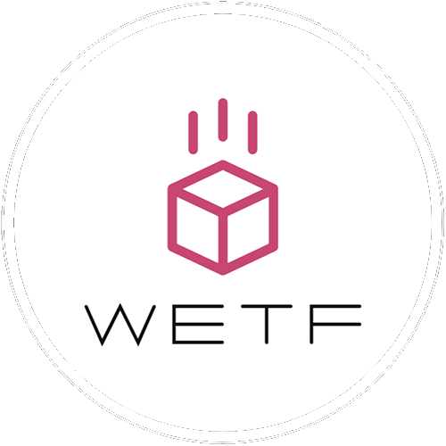

# Wetf

<p align="center">
  
</p>

A highly customizable and stupid fast ETF (External Term Format) encoder/decoder for NodeJS and Browsers.

External Term Format, or ETF, is the binary serialization format used by Erlang and Elixir for inter-process communication. ETF has seen prominent usage in many languages and systems as a replacement to JSON, mostly for languages that are better equipped to deal with binary formats rather than string-based formats. ETF is also often used for websocket communication with online API's such as the Discord API.

ETF has very loose definitions and rules for how data should be encoded between languages, especially since JavaScript and Erlang are vastly different, therefore **Wetf** is highly customizable and gives the user a lot of options for how the data should be encoded and decoded.

In addition, **Wetf** is [very fast](#benchmark), it was designed for absolute performance and tries to squeeze every inch of juice out of the JS engine.

## Installation

**Wetf** works everywhere, including Node.js, Browsers, Deno, Bun, Electron and more.

### Runtimes

Installation for various runtimes can be done using most package managers:

```sh
npm i wetf
pnpm add wetf
yarn add wetf
bun add wetf
```

Likewise, it can be used in any format desired:

```js
// cjs
const { Packer, Unpacker } = require("wetf");
const Packer = require("wetf/packer");

// esm
import { Packer, Unpacker } from "wetf";

// deno with npm
import { Packer, Unpacker } from "npm:wetf";

// deno with unpkg
import { Packer } from "https://unpkg.com/wetf/esm/packer.mjs";

// deno with jsdelivr
import { Unpacker } from "https://cdn.jsdelivr.net/npm/wetf/esm/unpacker.mjs";
```

### Browsers

For Browsers you can access both the UMD versions (`.js`) and the ESM versions (`.mjs`) via `unpkg` or `jsdelivr`. There are separate versions to include only the Packer or only the Unpacker. The package ships unminified files; `jsdelivr` can also provide minified UMD files.

```js
// UMD via jsdelivr
"https://cdn.jsdelivr.net/npm/wetf/umd/{packer | unpacker | wetf}.js"

// minified UMD via jsdelivr
"https://cdn.jsdelivr.net/npm/wetf/umd/{packer | unpacker | wetf}.min.js"

// ESM via jsdelivr
"https://cdn.jsdelivr.net/npm/wetf/esm/{packer | unpacker | wetf}.mjs"

// UMD via unpkg
"https://unpkg.com/wetf/umd/{packer | unpacker | wetf}.js"

// ESM via unpkg
"https://unpkg.com/wetf/esm/{packer | unpacker | wetf}.mjs"
```

Examples:

```html
<!-- regular script -->
<script src="https://cdn.jsdelivr.net/npm/wetf/umd/packer.min.js"></script>
<script>
    const { Packer } = Wetf;
</script>
```

```html
<!-- requirejs -->
<script>
    require(["https://cdn.jsdelivr.net/npm/wetf/umd/unpacker.min.js"], function(exports) {
        const { Unpacker } = exports.Wetf;
    });
</script>
```

```html
<!-- systemjs -->
<script>
    System.import("https://cdn.jsdelivr.net/npm/wetf/umd/wetf.min.js").then(Wetf => {
        const { Packer, Unpacker } = Wetf;
    });
</script>
```

```html
<!-- esm -->
<script type="module">
    import { Packer, Unpacker } from "https://cdn.jsdelivr.net/npm/wetf/esm/wetf.mjs";
</script>
```

### Usage

**Wetf** offers two classes, a Packer and an Unpacker:

## Packer

The **Wetf** Packer is used to convert JavaScript objects and data into the binary ETF format.  
A Packer instance contains a single `pack` method that synchronously returns an instance of Uint8Array containing the binary data.  

```js
const packer = new Packer({
    // packer options
});

const etf = packer.pack({a:10,b:20}) // Uint8Array<[131,116,0,0,0,2,109,0,0,0,1,97,97,10,109,0,0,0,1,98,97,20]>
```

**Wetf** supports various compression methods, if an asynchronous compression method is used, the `pack` method will instead return a Promise that resolves into Uint8Array.

```js
const packer = new Packer({
    compression: "compressionstream"
});

const etf = await packer.pack({a:10,b:20}) // Uint8Array<[131,80,0,0,0,21,120,156,43,97,96,96,96,202,101,96,96,96,76,76,228,2,211,73,137,34,0,30,78,2,246]>
```

### Packer Options

All options are optional.

| option | type | default | description |
|---|---|---|---|
| poolSize | number | 1048576 | Initial size of the internal memory buffer in bytes |
| useLegacyAtoms | boolean | false | If enabled, Atoms will be encoded using the legacy `ATOM_EXT` formats instead of the newer `ATOM_UTF8_EXT`. Legacy atoms are slightly faster but are limited to the latin1 character set |
| cacheKeys | boolean | false | Cache object keys for faster encoding of repeated keys |
| compression | [Compression Method](#compression-method) | false | Enable data compression and specify the compression method |
| encoding | [Encoding Options](#encoding-options) | {} | Customize encoding behavior |

### Compression Method

**Wetf** has two built-in compression methods and also allows a user-defined function for compressing with third party libraries such as `pako` or `fflate`:

| method | description |
|---|---|
| false | Do not compress (default) |
| true | Compress using "zlib" if available, fallback to "compressionstream" |
| "zlib" | Compress using `deflateSync` from NodeJS's native zlib module (not available in browsers) |
| "compressionstream" | Compress using `CompressionStream` from native web streams. This method is Async and will make `pack` return a Promise (available in modern browsers and node 18+) |
| (Uint8Array) => Uint8Array \| Promise\<Uint8Array\> | Compress using a custom function. If the function is Async, `pack` will return a Promise |

### Encoding Options

This object controls the encoding behavior and determines which JavaScript data types should be encoded into which ETF types, limited to what makes reasonable sense.

| option | values | default | description |
|---|---|---|---|
| string | "binary", "utf8-string", "char-string", "char-list" | "binary" | Encode strings as UTF-8 `BINARY_EXT`, UTF-8 `STRING_EXT`, Latin-1 `STRING_EXT` or a proper `LIST_EXT` of Unicode characters |
| key | "binary", "utf8-string", "char-string", "atom" | "binary" | Encode object keys as UTF-8 `BINARY_EXT`, UTF-8 `STRING_EXT`, Latin-1 `STRING_EXT` or `ATOM_*_EXT`. Select `"atom"` explicitly for Erlang protocols expecting atom keys |
| safeInt | "bigint", "float" | "bigint" | Whether integers between 32 and 53 bits should be encoded as `SMALL_BIG_EXT` or `NEW_FLOAT_EXT` |
| safeBigInt | "number", "bigint" | "number" | Whether BigInts smaller than 32 bits should be encoded as `*_INTEGER_EXT` or `SMALL_BIG_EXT` |
| null | "atom", "nil" | "atom" | Whether null should be encoded as the Atom `nil` or as `NIL_EXT` |
| undefined | "atom", "null", "ignore" | "atom" | Whether undefined should be encoded as the Atom `undefined`, converted to null or ignored\* |
| infinity | "atom", "null", "ignore" | "atom" | Whether Infinity should be encoded as the Atoms `positive_infinity` and `negative_infinity`, converted to `null` or ignored\* |
| nan | "atom", "null", "ignore" | "atom" | Whether NaN should be encoded as the Atom `nan`, converted to `null` or ignored |
| buffer | "binary", "bitbinary", "string" | "binary" | Whether Buffers and TypedArrays should be encoded as `BINARY_EXT`, `BIT_BINARY_EXT` or `STRING_EXT` |
| array | "list", "improperlist", "tuple" | "tuple" | Encode arrays as proper nil-terminated lists, improper lists or tuples. Empty arrays use `NIL_EXT` in either list mode and a zero-arity tuple in tuple mode |

### Packer Limitations

#### The Packer currently cannot create the following ETF types:

`Distribution Header`, `ATOM_CACHE_REF`, `FLOAT_EXT`, `PORT_EXT`, `NEW_PORT_EXT`, `V4_PORT_EXT`, `PID_EXT`, `NEW_PID_EXT`, `REFERENCE_EXT`, `NEW_REFERENCE_EXT`, `NEWER_REFERENCE_EXT`, `FUN_EXT`, `NEW_FUN_EXT`, `EXPORT_EXT`, `RECORD_EXT`

#### The following JS objects are always ignored and their contents are not serialized:

`Map`, `Set`, `Date`, `Error`, `ArrayBuffer`, `Function`, `RegExp`

Methods to create and support some of these types and objects might be added in the future, feel free to open a feature request or issue.

#### The following JS objects may have special rules and behavior:

`Symbol`s are stringified to `Symbol(description)` and encoded as strings.

Buffer, TypedArrays and DataView are encoded as raw bytes, respecting their byte offset and byte length.

Objects are encoded using their own enumerable properties. Replacement functions like `toJSON` are not supported.

Values encoded as `STRING_EXT` are limited to 65,535 bytes according to the [ETF specification](https://www.erlang.org/doc/apps/erts/erl_ext_dist.html#string_ext) and the Packer will throw a RangeError if exceeded. For longer strings, use `BINARY_EXT` or `LIST_EXT`.

The Packer does not validate strings for lossless encoding. Latin-1 encoding truncates UTF-16 code units above 255 to their low byte; UTF-8 encoding invalid sequences with `U+FFFD`.

Values encoded as `ATOM`s follow the wire format limit of 65,535 bytes, not Erlang's hard limit of 255 characters per atom. The Packer allows these atoms to be encoded, but atoms larger than 255 characters may fail to decode in a real Erlang application.

Ignored values have their object properties omitted and array elements removed from the serialized output. Use `null` encoding if preserving indexes or keys is required. If the top-level value is ignored, `pack()` encodes `NIL_EXT` (the empty list).

## Unpacker

The **Wetf** Unpacker is used to convert ETF binary data into JavaScript objects and values.  
An Unpacker instance contains a single `unpack` method that synchronously processes the binary data and returns a JavaScript value.  

```js
const unpacker = new Unpacker({
    // unpacker options
});

const etf = new Uint8Array([131,116,0,0,0,2,109,0,0,0,1,97,97,10,109,0,0,0,1,98,97,20]);
const js = unpacker.unpack(etf) // { a: 10, b: 20 }
```

Compressed data is automatically decompressed when encountered. If an asynchronous decompression method is used, the `unpack` method will instead return a Promise that resolves into the JavaScript value.

```js
const unpacker = new Unpacker({
    decompression: "decompressionstream"
});

const etf = new Uint8Array([131,80,0,0,0,21,120,156,43,97,96,96,96,202,101,96,96,96,76,76,228,2,211,73,137,34,0,30,78,2,246]);
const js = await unpacker.unpack(etf) // { a: 10, b: 20 }
```

### Unpacker Options

All options are optional.

| option | type | default | description |
|---|---|---|---|
| decompression | [Decompression Method](#decompression-method) | - | Specify the decompression method |
| decoding | [Decoding Options](#decoding-options) | {} | Customize decoding behavior |
| browserStrictLatin1 | boolean | true | Enforce decoding the full Latin-1 character set (bytes 0-255) in browsers. Disabling this improves performance for large strings in browsers but only guarantees correct decoding within the ASCII range (bytes `0-127`). |
| atomTable | object | [Default Atom Table](#default-atom-table) | Defines substitutions for atom values, unmapped atoms are decoded as strings. Does not affect object keys |
| cacheKeys | boolean | false | Cache object keys for faster decoding of repeated keys (string, binary and atom keys only) |
| cacheAtoms | boolean | false | Cache atom values for faster decoding of repeated atoms (both atomTable and unmapped atoms) |

### Decompression Method

**Wetf** has two built-in decompression methods and also allows a user-defined function for decompressing with third party libraries such as `pako` or `fflate`:

| method | description |
|---|---|
| "zlib" | Decompress using `inflateSync` from NodeJS's native zlib module (not available in browsers) |
| "decompressionstream" | Decompress using `DecompressionStream` from native web streams. This method is Async and will make `unpack` return a Promise (available in modern browsers and node 18+) |
| (Uint8Array) => Uint8Array \| Promise\<Uint8Array\> | Decompress using a custom function. NodeJS Buffers are also accepted because they extend Uint8Array. If the function is Async, `unpack` will return a Promise |

If no decompression method is set, **Wetf** will decompress using "zlib" if available and fallback to "decompressionstream";

### Decoding Options

This object controls the decoding behavior and determines which ETF data types should be decoded into which JavaScript values, limited to what makes reasonable sense.

| option | value | default | description |
|---|---|---|---|
| nil | "null", "array" | "array" | Whether `NIL_EXT` should be decoded as `null` or as `[]` |
| string | "utf8", "latin1", "buffer", "uint8array", "array" | "latin1" | Whether `STRING_EXT` should be decoded as text (utf8 or latin1) or as bytes (Buffer, Uint8Array or Array) |
| stringKey | "utf8", "latin1" | "latin1" | Whether `STRING_EXT` object keys should be decoded as utf8 or latin1 text |
| binary | "utf8", "latin1", "buffer", "uint8array", "array" | "utf8" | Whether `BINARY_EXT` should be decoded as a text (utf8 or latin1) or as bytes (Buffer, Uint8Array or Array) |
| binaryKey | "utf8", "latin1" | "utf8" | Whether `BINARY_EXT` object keys should be decoded as utf8 or latin1 text |
| bitbinary | "utf8", "latin1", "buffer", "uint8array", "array" | "uint8array" | Whether `BIT_BINARY_EXT` should be decoded as a text (utf8 or latin1) or as bytes (Buffer, Uint8Array or Array) |
| list | "array", "string" | "array" | Whether `LIST_EXT` should be decoded as array of values or as text (list of unicode characters). Supports both proper and improper tails. String decoding supports byte-string continuation tails |
| bigint | "bigint", "string" | "bigint" | Whether `*_BIG_EXT` should be decoded as bigint or as a numeric string |
| safebigint | "number", "bigint", "string" | "number" | Whether `*_BIG_EXT` integers within JavaScript's safe integer range should be decoded as number, bigint or numeric string |

### Default Atom Table

A table of atoms and the JavaScript values they represent. The default atom table looks like this:

```js
{
    "true": true,
    "false": false,
    "undefined": undefined,
    "null": null,
    "nil": null,
    "nan": NaN,
    "infinity": Infinity,
    "positive_infinity": Infinity,
    "negative_infinity": -Infinity
}
```

If a custom `atomTable` is defined, it replaces the entire default table. To simply add an atom to the default table, copy it first and then add your atoms.

### Unpacker Limitations

The Unpacker currently cannot unpack the following ETF types:

`Distribution Header`, `ATOM_CACHE_REF`, `PORT_EXT`, `NEW_PORT_EXT`, `V4_PORT_EXT`, `PID_EXT`, `NEW_PID_EXT`, `REFERENCE_EXT`, `NEW_REFERENCE_EXT`, `NEWER_REFERENCE_EXT`, `FUN_EXT`, `NEW_FUN_EXT`, `EXPORT_EXT`, `RECORD_EXT`

Support for these types might be added in the future, feel free to open a feature request or issue.

## Benchmark

A decent amount of JS trickery went into creating **Wetf** in order to make it fast. In this benchmark, several libraries were compared by measuring the time taken to process each sample data file **100,000** times. The results below are the lowest recorded times in milliseconds after 5 repeated runs and were measured on Node.js v26.13.0, Windows x64, Intel Core i7-12700H.

### Encoding

| Sample | **[wetf](https://www.npmjs.com/package/wetf/v/1.0.0)** | [etf.js](https://www.npmjs.com/package/etf.js) | [erlpackjs](https://www.npmjs.com/package/erlpackjs) | [erlang_js](https://www.npmjs.com/package/erlang_js) | [@devsnek/earl](https://www.npmjs.com/package/@devsnek/earl) | [@typescord/ftee](https://www.npmjs.com/package/@typescord/ftee) | [erlpack](https://www.npmjs.com/package/erlpack) |
|---|---:|---:|---:|---:|---:|---:|---:|
| [discord-guild](benchmarks/samples/discord-guild.json) | **1446** | 14073 | 20125 | 21735 | 21825 | 3465 | 8711 |
| [discord-message](benchmarks/samples/discord-message.json) | **796** | 8821 | 9576 | 10388 | 10082 | 1778 | 4662 |
| [geojson-features](benchmarks/samples/geojson-features.json) | **545** | 5172 | 5059 | 8767 | 4869 | 1272 | 4074 |
| [github-issue](benchmarks/samples/github-issue.json) | **652** | 7834 | 8658 | 8649 | 8458 | 1532 | 3107 |
| [graphql-response](benchmarks/samples/graphql-response.json) | **776** | 8732 | 10052 | 11586 | 9911 | 1810 | 3934 |
| [openweather-current](benchmarks/samples/openweather-current.json) | **291** | 2985 | 2806 | 4172 | 2716 | 862 | 2225 |
| [reddit-listing](benchmarks/samples/reddit-listing.json) | **1117** | 13399 | 16782 | 16481 | 16342 | 2471 | 4914 |
| [shopify-order](benchmarks/samples/shopify-order.json) | **1156** | 14062 | 17100 | 17345 | 15610 | 3178 | 5360 |
| [slack-message](benchmarks/samples/slack-message.json) | **683** | 7761 | 8310 | 8880 | 7979 | 1562 | 3494 |
| [spotify-track](benchmarks/samples/spotify-track.json) | **635** | 8914 | 7847 | 8453 | 7655 | 1475 | 3530 |
| [stripe-event](benchmarks/samples/stripe-event.json) | **649** | 9641 | 8986 | 9140 | 8692 | 1561 | 3117 |
| [tiny](benchmarks/samples/tiny.js) | **91** | 1290 | 1064 | ERROR | 1035 | 459 | 1481 |

### Decoding

| Sample | [wetf](https://www.npmjs.com/package/wetf/v/1.0.0) | [etf.js](https://www.npmjs.com/package/etf.js) | [erlpackjs](https://www.npmjs.com/package/erlpackjs) | [erlang_js](https://www.npmjs.com/package/erlang_js) | [@devsnek/earl](https://www.npmjs.com/package/@devsnek/earl) | [@typescord/ftee](https://www.npmjs.com/package/@typescord/ftee) | [erlpack](https://www.npmjs.com/package/erlpack) |
|---|---:|---:|---:|---:|---:|---:|---:|
| [discord-guild](benchmarks/samples/discord-guild.json) | **1966** | 6250 | 8362 | 7487 | 8716 | 7926 | 6563 |
| [discord-message](benchmarks/samples/discord-message.json) | **895** | 3121 | 4516 | 3993 | 4288 | 4040 | 2617 |
| [geojson-features](benchmarks/samples/geojson-features.json) | **532** | 1765 | 2461 | 4825 | 2324 | 2221 | 1919 |
| [github-issue](benchmarks/samples/github-issue.json) | **882** | 2706 | 3892 | 3256 | 3584 | 3186 | 1738 |
| [graphql-response](benchmarks/samples/graphql-response.json) | **871** | 2888 | 4083 | 4113 | 3964 | 3478 | 2091 |
| [openweather-current](benchmarks/samples/openweather-current.json) | **297** | 1106 | 1748 | 2317 | 1500 | 1566 | 942 |
| [reddit-listing](benchmarks/samples/reddit-listing.json) | **1539** | 5296 | 6725 | 5846 | 6263 | 5396 | 3021 |
| [shopify-order](benchmarks/samples/shopify-order.json) | **1488** | 5317 | 6909 | 7658 | 6025 | 5714 | 3193 |
| [slack-message](benchmarks/samples/slack-message.json) | **769** | 3312 | 3413 | 3408 | 3012 | 2958 | 1572 |
| [spotify-track](benchmarks/samples/spotify-track.json) | **755** | 3102 | 3442 | 3388 | 3325 | 2875 | 1599 |
| [stripe-event](benchmarks/samples/stripe-event.json) | **952** | 3706 | 4093 | 3578 | 3899 | 3276 | 1841 |
| [tiny](benchmarks/samples/tiny.js) | **65** | 301 | 376 | 437 | 298 | 265 | 233 |

### Running

Benchmark scripts and samples are included in the published package. Their dependencies are in [`benchmarks`](benchmarks/package.json) and are not installed by default. Install them before running comparisons:

```sh
npm install --prefix benchmarks
npm run benchmark -- --help
npm run benchmark -- --sample discord-guild --lib wetf --iterations 100000 --rounds 5
npm run benchmark -- --sample all --lib all --iterations 9999 --rounds 5
```

## License

**Wetf** is licensed under MIT for simplicity and ease of access to other developers, however, if you're an individual or a company using this library in commercial products and/or services, consider sponsoring this project.
